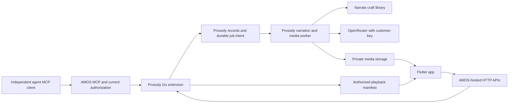

# RFC 0001: Prosody — an agent-fed listening and viewing inbox

Date: 2026-10-30

Status: Draft for review. Product requirements below were confirmed by the owner; the proposed architecture and contracts are not accepted implementation decisions.

Scope: Hosted web service and Flutter mobile application, with iOS as the first release.

## 1. Purpose

Prosody receives material from AI agents and makes it pleasant for people to consume. Text becomes a concise, carefully written spoken briefing. Images illustrate the explanation. Supplied audio and video play without editorial alteration. A person moves through their private inbox or a shared team feed by swiping upward, or listens continuously with their phone locked.

The product combines the usefulness of an inbox with the immediate, full-screen presentation of a short-video feed. It has no public recommendation network, social engagement loop, or human-to-agent conversation in MVP. Agents submit content and can disconnect; they do not need to poll for human replies.

Success means an independently operated MCP client can receive permission to a destination, submit content once, and have the intended people consume it in a minimal mobile experience. Text narration must preserve the source's important meaning while reducing the effort and time required to understand it.

## 2. Confirmed product requirements

| Area | Requirement |
| --- | --- |
| Audience | Private personal inboxes and shared team spaces. |
| Feed selection | People explicitly switch between their personal inbox and individual team feeds. No combined feed in MVP. |
| Presentation | Continuous, vertically swipeable items: swipe up for the next item. |
| Direction | Agent to human only. No replies, approvals, acknowledgements sent to agents, or agent inbox polling. |
| Text | Condense into a spoken briefing using Narrate's narration craft. Preserve access to the submitted text. |
| Duration | Prosody chooses the appropriate narration length. All generated narration within one item totals at most ten minutes. Ten minutes is a ceiling, not a target. |
| Supplied media | Play supplied audio/video unchanged. The ten-minute narration ceiling does not limit supplied media. |
| Mixed content | One item can contain an ordered sequence of narrated text with images and supplied audio/video clips. |
| Images | Agents should provide explanatory text with images. Automatic image interpretation is not required in MVP. |
| Progress | Each person has their own reading and listening progress, including in shared feeds. |
| Playback | Continuous playback in the background and with the screen locked. |
| Platforms | Flutter from the beginning; release and qualify iOS first. Preserve an Android implementation path. |
| Agent connection | Remote Streamable HTTP MCP with Client ID Metadata Documents (CIMD). No framework-specific agent dependency. |
| Foundation | Build on AMOS rather than reimplementing its application foundation. |
| Backend deployment | Go application deployed on a VM as a Nanos unikernel. |
| Generation choices | Model selection from OpenRouter and voice selection are available from day one. |
| Credentials | Users supply their own OpenRouter keys. |
| Team preferences | Shared team narration settings in MVP. Personal inbox settings belong to the person. |
| Notifications | Off by default; people can enable arrival notifications separately for each feed. |
| Connectivity | Background streaming and buffering in MVP. Explicit offline downloads are deferred. |

“Like TikTok” describes the swipe interaction and immediate visual presentation. It does not import TikTok's current upload limits, recommendation algorithms, or social features. There is no requirement to truncate an agent's supplied recording to ten minutes.

## 3. Proposed ownership and integration shape

Use an **AMOS-hosted Go business extension** for Prosody's domain operations. Expose mobile HTTP APIs and MCP tools through the same AMOS application and policy boundary. Define operations in OpenAPI plus AMOS policy metadata; generate transport bindings where supported. Keep Flutter as a separate client of these APIs.

This is the proposed integration shape being shared for AMOS coordination, not a claim that the complete host composition is available today.

| Component | Responsibility |
| --- | --- |
| AMOS | Human identity, personal/team workspace lifecycle, memberships, current authorization, consent/grants, application API/MCP admission, audit, and supported durable-job infrastructure. |
| Prosody Go extension | Feeds, submission admission, source material, ordered media manifests, narration records, playback manifests, per-person progress, preferences, provider configuration, and content lifecycle. |
| Prosody workers | Bounded script generation, speech synthesis, media validation, derived playback assets, and atomic publication. Use one durable job lifecycle. |
| Narrate public library | Narration craft assets and script rewriting/validation primitives. No copied prompt fork or assumed hosted speech service. |
| OpenRouter adapters | Use the configured customer's key for selected text-generation and speech models, subject to current budgets and provider policy. |
| Flutter app | Feed presentation, playback, original-text access, progress synchronization, model/voice preferences, and platform media controls. |
| Object storage | Private original and generated assets, accessed through scoped delivery authorization. |

AMOS remains the authority for its identity and workspace records. Prosody owns its domain records through supported extension and migration seams. Do not query AMOS private tables from a separate service or trust user-supplied identity headers. An integrated application can share a deployment/database while preserving explicit schema and API ownership.



A separate Prosody resource server is deferred: it would need the unfinished AMOS current-caller identity bridge. The integrated approach still requires a qualified MCP-to-application-principal bridge, current permission checks, and worker authority; hosting code in the same process does not establish these properties automatically.

The web service includes browser surfaces needed for sign-in, invitations, MCP consent, and account configuration, preferably through AMOS. A full browser listening client is outside MVP. This RFC does not adopt the remote-control/approval design of the older, separate project with the same Prosody name.

### 3.1 Confirmed deployment target

The owner selected Go deployed as a Nanos unikernel on a VM. Nanos runs a single application process; do not assume shell commands or subprocess workers are available. Proposed composition is one Go executable hosting AMOS and Prosody, with bounded worker goroutines and durable external database/object storage. Media tools that require subprocesses need a qualified library or separately authorized service adapter. [Nanos architecture](https://github.com/nanovms/nanos/wiki/Architecture).

Qualify AMOS composition, Go runtime compatibility, TLS, durable jobs, media processing, secret delivery, restart recovery, observability, image upgrades, and rollback on the exact Nanos image. Existing AMOS container/development receipts do not qualify this deployment. VM provider, sizing, and image tooling remain implementation choices. Infrastructure changes use repository-owned IaC, with Go/Pulumi preferred; this design does not authorize deployment or spending.

## 4. Mobile experience

Approved visual direction: Current's flowing mark and rounded typography with Frame's white, charcoal, ultramarine, and cool-gray palette. Swipe upward to listen/watch the next item. Audio-only items include a playback-driven waveform alongside title and controls; pause freezes it, reduced motion uses a static treatment, and background playback does not require visual animation. The waveform represents playback, not microphone capture.

### 4.1 Joining and connecting an agent

1. Sign in through a qualified AMOS mobile authentication flow. A personal inbox belongs to the user's personal workspace; team feeds belong to team workspaces.
2. Configure an OpenRouter key, choose a briefing model, and select a voice. The proposed speech implementation also exposes compatible speech-model selection.
3. Copy the MCP endpoint into a compatible agent client. Its OAuth flow opens consent, where the person chooses an authorized destination and grants submission access.
4. Return to the app and receive the first briefing. The empty state gives a concise agent connection example rather than showing a dashboard of configuration.

Team administrators configure a shared model/voice profile and a team-scoped OpenRouter credential supplied by an authorized administrator. Other members cannot retrieve that key. Joining a team does not require each listener to pay for a separate rendering.

### 4.2 One item, one playback timeline

The main surface shows one item at a time. Keep controls to feed selection, source/title, playback, progress, and an overflow/detail surface. Use restrained typography and spacing; images/video occupy the stage when present. Text-only items use a readable title and short summary instead of artificial video decoration.

Within an item, explanatory narration accompanies its associated images, followed by the next authored segment. Audio/video clips play in their submitted order. There is never competing narration over supplied clip audio. Swiping up skips the remainder of the current item and advances to the next; it does not mark the skipped content as consumed. Seeking within an item uses the playback control, keeping the swipe gesture unambiguous.

The detail surface distinguishes the condensed narration script from the original submitted text. Sources and links remain accessible without reading raw URLs aloud. Settings and operational diagnostics stay out of the playback surface.

Proposed queue default: start at the oldest unconsumed ready item in the selected feed and continue in publication order. Allow replay of completed items. New arrivals append without interrupting playback or changing the current item's position. Stable cursor ordering uses publication time and item identity. Switching feeds stops the old queue and restores that person's position in the selected feed.

### 4.3 Background behavior

One playback coordinator owns the queue in foreground and background. Lock-screen and headset controls operate the same timeline: play/pause, seek, and next. Audio focus interruptions pause/resume predictably; unplugging headphones must not unexpectedly resume through the speaker.

When a video has an audio track, its audio continues in the background without rewriting or replacing it. Returning to the app restores the video at the corresponding timestamp. Silent visual segments may advance on their authored/default duration; track them as passed in audio-only mode, not visually viewed. Image explanations come from the agent's text; Prosody does not invent descriptions for unseen visuals. Visually dependent items remain available to revisit.

Flutter is the shared application framework, not evidence of platform playback readiness. Qualify native iOS audio-session behavior, locked-screen queue transitions, media controls, authentication return handling, and notification links on a physical device. Android release acceptance is separate even if shared code compiles.

### 4.4 Progress and notifications

Store progress by person, feed, item revision, and segment. Keep playback offset, listened coverage, visual exposure, and explicit marked-read state distinct. Opening an item or swiping past it is not completion. Proposed completion rule: every playable segment reaches its end and at least 90% of its timeline has actually played; visual-only content needs a foreground view or explicit mark-read. Seeking to the end does not satisfy coverage.

Position updates use a session sequence/revision so delayed writes cannot roll back newer progress. Coverage can accumulate independently; shared team content never shares one person's completion state with another. Progress is for human consumption, not an agent-visible receipt or analytics tool in MVP.

Notifications are user-controlled per feed and require OS permission. Emit only when an item becomes playable, at most once per person/item publication. A source arriving and its narration finishing are not separate notifications. Default lock-screen payloads omit private content; authorization is checked when opening the item.

## 5. Content model and ingestion

An item contains immutable source material and an ordered segment manifest. A **narration segment** contains text plus zero or more associated images. A **media segment** references supplied audio or video. A visual-only segment is allowed, but explanatory text is encouraged. A minimal text message is one narration segment.

| Record | Main fields and invariants |
| --- | --- |
| Feed | Stable ID, AMOS workspace binding, personal/team kind, settings revision. One personal feed and one feed per team workspace initially. |
| Submission | Submitter principal/grant reference, destination, idempotency key, canonical payload digest, accepted time, status. |
| Item | Feed, source/title, immutable content revision, source segments, publication time, availability. |
| Asset | Owning workspace, upload identity, hash, detected type, byte size, duration where applicable, private storage reference. |
| Rendition | Item revision, selected models/voice, settings revision, craft digest, script, generated assets, measured narration duration, provider usage. |
| Progress | Person/item revision, segment offsets and coverage, foreground view state, completion state, update ordering. |
| Provider configuration | Personal/team scope, encrypted key reference, model/voice selection, admission limits, revision. No plaintext key in job payloads. |

Original audio/video bytes are retained. “Unchanged” means no summarization, redubbing, trimming, inserted narration, or editorial reordering. Where playback compatibility requires a derivative, preserve timing and content, retain the original, and identify the derivative. Validate accepted formats before promising playback; unsupported media must fail explicitly rather than being silently changed.

Large content uses a prepare-upload, upload, and finalize flow. The service issues bounded upload authorization; finalization verifies ownership, actual bytes/type, checksum, and finite limits. Assets cannot cross workspace boundaries. The submitted manifest references only validated assets owned by the destination. Incomplete uploads never create playable items and expire under an explicit cleanup policy.

For longer text and mixed content, propose a validated manifest upload followed by a flat MCP operation carrying its upload ID. This avoids forcing nested media structures through AMOS's current flat MCP mapping. The domain validator still enforces a versioned manifest schema; the upload does not permit arbitrary unbounded JSON. Long text remains one briefing with one ten-minute generated-narration budget, not automatic splitting into many ten-minute items.

Media byte sizes, source-text sizes, segment counts, decoded image dimensions, upload TTLs, and per-feed submission rates must be finite and discoverable. Their exact values require capacity measurements before implementation acceptance. The supplied-media duration policy is separate from the confirmed ten-minute generation ceiling. No arbitrary remote URL fetching is needed in the first slice; agents upload bytes through scoped URLs.

## 6. Narration and model selection

### 6.1 A briefing, not a document reading

Reuse `github.com/narrate-it/narrate/narration` through its public API. The library provides craft assembly, provenance, chunking, and host-controlled rewriting; speech synthesis is a separate adapter. Prosody adds the explicit condensation objective, segment structure, and aggregate duration constraint. Reuse alone does not prove that every generated script meets these requirements.

The script should lead with the main result, select relevant supporting detail, explain necessary context, and preserve consequential caveats, uncertainty, numbers, and attribution. Remove repetition, document scaffolding, and details that can stay in the original. Do not fabricate conclusions, turn speculation into fact, or narrate text as instructions to the application. Preserve the source language by default; unsupported model/voice language combinations fail visibly rather than silently translating.

Images are shown with the agent's explanation. MVP does not send images to a vision model to infer facts. Narration should remain understandable without looking at the screen whenever the supplied explanation makes that possible. Submitted audio/video never enters the script-rewriting pipeline.

### 6.2 Bounded generation

1. Validate the submission, destination, current grant, provider configuration, and finite generation budget.
2. Persist the source, receipt, settings snapshot, and durable work intent atomically.
3. Build a condensed script with Narrate craft and the selected OpenRouter text model. Keep source input separate from privileged instructions.
4. Validate the result against source coverage, segment association, and a conservative duration estimate. Preserve the script and craft/model provenance.
5. Synthesize speech with the selected compatible voice, chunking at speech boundaries when required by the provider.
6. Measure the generated audio's actual duration across **all narration segments in the item**. Publish only if the total is at most 600 seconds at normal playback speed.
7. If too long, perform at most one additional admitted shortening/synthesis cycle. If it still fails, expose a retryable generation failure. Never chop the last minutes, accelerate speech to evade the cap, or publish a partial ending as success.
8. Commit one complete playback manifest and readiness event. MVP streams completed recordings to the app; live token-to-audio generation is not required.

The service chooses a substantially shorter duration when the content allows it. No agent-provided preference can raise the maximum. Source text remains readable if narration fails. The mobile queue skips processing/failed items; these remain visible in a compact activity/detail surface with an actionable reason.

### 6.3 OpenRouter and voices

The briefing-model picker uses OpenRouter's model catalog, filtered to compatible text-output models and the customer's configured provider constraints. Store stable provider model IDs, validate context/output limits at admission, and disclose unavailable choices. Do not silently replace a selected model with an arbitrary alternative. Catalog availability is not proof of narration quality. [OpenRouter models API](https://openrouter.ai/docs/api/api-reference/models/list-all-models-and-their-properties).

Proposed MVP speech path: use OpenRouter's speech endpoint too. It provides `/api/v1/audio/speech`; compatible models advertise speech output, and voice IDs are model-specific. Present only supported model/voice combinations, with a sample preview, rather than a voice name disconnected from its provider. Exact selectable models require provider acceptance testing. [OpenRouter speech documentation](https://openrouter.ai/docs/guides/overview/multimodal/tts).

Personal settings apply to the personal inbox. A team administrator chooses shared team settings, so one rendition serves all team members. Changes apply to future submissions; they do not silently regenerate the backlog or charge for every listener. Explicit regeneration creates a new rendition and preserves progress against the previous rendition. Freeze the selected settings for queued work, but recheck current credential/grant authority before each external call.

Keys are encrypted server-side under a managed secret boundary and never returned after entry, logged, placed in MCP arguments, embedded in assets, or sent to other members. The Flutter client holds the user's application session securely, not a reusable copy of a team provider key. Key replacement/revocation stops new provider calls using the old reference. Provider keys are not authorization to post into a feed.

Expose generation usage and finite per-job and per-workspace cost/concurrency limits. BYOK does not authorize unlimited spend. Voice previews and repairs consume the same admission budget. Missing/exhausted keys leave a clear status and do not fall back to Prosody-funded generation. Audio/video-only submissions do not require a generation credential.

## 7. Smallest AMOS integration contract

### 7.1 First operation: submit one text message

The first end-to-end integration should use one mutation, without attachments or a custom conversation protocol. The contract below is a proposed integration target, not an operation qualified by the current MCP candidate. Corrected coordination information reports that the continuation amendment in candidate `3377b54a`'s `docs/contracts/mcp-endpoint-source.md` explicitly adds descriptor-bound resource selectors and durable effects. The initial exclusions belong to an earlier checkpoint and must not be applied to the candidate as a whole. Compatibility between those amended contracts and Prosody's feed-bound submission, and qualification of the final head, still require verification.

| Field | Proposed contract |
| --- | --- |
| Stable operation ID | `prosody.messages.submit-text` |
| MCP tool | `prosody_submit_text` |
| HTTP route | `POST /prosody/v1/messages/submit-text`, subject to AMOS route registration. |
| Proposed MCP input | Closed flat object: `feedId`, `idempotencyKey`, `text`; optional `title`. Workspace comes from consent, not tool arguments. Tool-input idempotency remains an unqualified AMOS extension requirement. |
| Bounds | Feed ID: canonical UUIDv7; idempotency key: 1–256 UTF-8 bytes (decoded value; enforce in runtime even if JSON Schema `maxLength` counts characters); title: 1–160 when supplied; text: 1–4,096 characters, nonblank. |
| Target AMOS mapping | `workspaceSelection: active_principal`, using the consent-selected workspace; canonical UUIDv7 feed selected by JSON pointer `resourceField: /feedId`, subject to current destination authorization. No `explicit_member` expansion for Prosody MCP. This confirmed integration contract still requires exact-source and runtime qualification. |
| Policy | Permission `prosody.messages.submit`; minimum assurance `aal1`; side effect `write`; idempotency `required`; MCP exposure `eligible`; no paid entitlement in this first slice. |
| Actor | AMOS-resolved current principal plus destination-scoped submission grant. No caller-supplied sender or role. |
| Success | HTTP 202 / structured MCP result with `itemId`, `workId`, `status: accepted`, and `acceptedAt`. `itemId` identifies the submitted source and resulting feed item; `workId` identifies the durable work intent. `acceptedAt` is the original persisted acceptance timestamp. Replays retain these receipt values regardless of later processing status; no separate submission identity is introduced. |
| Durable effect | One source item and one work intent. Receipt means accepted, not narrated, published, or consumed. |

AMOS owner source inspection of `809e060e` confirms that `prosody.messages.submit-text` matches `operationIDPattern`, `prosody_submit_text` matches the MCP tool-name regex, and `/prosody/v1/messages/submit-text` satisfies business-path syntax outside reserved roots. This establishes identifier syntax compatibility only; complete descriptor registration and runtime acceptance remain unverified. Worker and mobile requirements are recorded in separate AMOS-owned dependency briefs; their design choices remain proposals.

The proposed classification treats enqueueing as a write and subsequent provider calls as separately admitted external effects under the recorded authority and budget. Review that classification and the durable-work boundary against the candidate's continuation amendment; a `write` label alone does not establish authority for later worker calls. Descriptor-bound feed selection and atomic durable enqueue remain distinct from downstream execution. Owner reconciliation of exact `809e060e64c00160d8751ad8a35b3d76e2436b45` now establishes an application-job integration gap: no supported public host seam was found for current person/membership/financial reauthorization and fenced external publication. That boundary needs design, review, implementation and qualification in AMOS. Missing provider setup fails admission for new text submissions; a provider failure after acceptance changes the durable processing status instead of erasing the receipt.

Prosody accepts consent-selected workspace and canonical UUIDv7 feed identifiers as its integration direction. The normalized domain request includes a trusted resolved workspace identity, but a client-supplied `workspaceId` must not override or switch the MCP grant's workspace. A different workspace requires an appropriately scoped consent/grant. Feed discovery returns the IDs available under that grant; labels remain presentation only. The handler checks current workspace membership, feed ownership and destination permission on each invocation.

Team-workspace support remains behind qualification. Latest owner-reported source review found native grant management always selects the personal workspace; acceptance of `active_principal` as a contract does not establish a working team consent or grant-management path. Do not enable team agent connections until the corrected selection and current-authority behavior are qualified. Account authorization and revocation remain unqualified for the current candidate, including personal workspaces.

The tool JSON `idempotencyKey` is authoritative for Prosody MCP. Ordinary agents supply that stable key without custom per-call header control. If an HTTP `Idempotency-Key` header is also present and differs, reject the request; the header cannot override the tool key or substitute for a missing required tool key. This supersedes the earlier header-only candidate description. AMOS reports descriptor-bound body-key implementation, but service qualification remains pending. The HTTP adapter and MCP adapter must normalize to the same domain identity and policy; their wire schemas need not be identical.

Key validation requires nonblank valid UTF-8 and 1–256 decoded bytes. The contract does not currently exclude leading/trailing whitespace or NUL/CR/LF in an otherwise nonblank key; preserve the decoded value without trimming or rewriting it. The owner reports isolated head `809e060e` aligns descriptor-bound JSON keys with this contract, preserves exact values, and requires equality with any parsed header; legacy header behavior remains unchanged. Independent source review reportedly found no blocking issue in this delta, and selected Go unit/fixture tests plus the JS tool-inventory unit test now reportedly pass on exact head `809e060e64c00160d8751ad8a35b3d76e2436b45`. These are not real service acceptance. This supersedes the earlier reported source mismatch, not the runtime qualification gate. The JSON operation path must not require keys to be copied into HTTP headers. Invalid UTF-8 and escaped lone-surrogate rejection also require exact-source review and tests; do not silently replace malformed Unicode and thereby change key identity. Source review does not establish executed Unicode-validation behavior or full persistence compatibility.

Candidate `4eaea3a37c29978c5445b29f849d22d55ef85424` reportedly includes ordinary real Go SDK body-key, replay/conflict, and controlled lost-response retry fixture source. Independent source review reportedly closed unsafe uncertain-retry and malformed-result findings. Required execution evidence must show that losing the first response and retrying the same tool payload/key returns the original durable receipt without a second submission or work intent. Changed feed/body under that key must still conflict. The final head has not been compiled or run. Reviewed fixture source is not a passing test: client/database/CIMD/lost-response qualification remains pending, with service execution awaiting an owned fixture and capacity admission.

Illustrative desired tool input, pending idempotency qualification:

```json
{
  "feedId": "019a3f00-1234-7000-8000-000000000001",
  "idempotencyKey": "daily-research-2026-10-30-r1",
  "title": "Research update",
  "text": "The experiment completed. The new approach reduced processing time, but the sample is small and the result needs another run."
}
```

The server verifies the feed belongs to the consent-selected workspace and the current principal/grant can submit there. The 4,096-character bound deliberately fits the inspected AMOS MCP mapping contract; it is the first inline-text slice, not the final product's total document limit. The operation does not require MCP nested objects, caller-supplied model credentials, or human response polling. Existing domain validation source is not yet a qualified MCP wire adapter.

Prosody accepts the owner-reported AMOS replay scope: installation/application/environment/workspace/person/operation, with the idempotency key identifying a logical submission within that scope. Feed is not a replay-scope dimension. Agents must generate a globally unique key for each new logical submission across feeds and reuse that key for retries. Global uniqueness is a client requirement; server replay/conflict enforcement remains within the AMOS scope above. Persist a canonical payload digest that includes `feedId`. Same key and same payload return the existing receipt without another job; changing the feed or other payload with the same key returns a conflict, not a separate submission. Intentionally sending identical text to two feeds requires two distinct keys. Retain deduplication identity across worker restarts and for a documented retry window, including deletion tombstones where needed. Clients may safely repeat the same submission after a lost response; they must not manufacture a new key to resolve an unknown result. This product contract is accepted; the exact AMOS implementation and cross-transport behavior remain qualification gates.

Return stable errors for invalid input, unauthenticated, forbidden, non-disclosing destination unavailable, idempotency conflict, provider setup required, quota exceeded, and dependency unavailable. The HTTP and MCP surfaces preserve equivalent domain error meaning. A database commit failure cannot return an accepted receipt.

### 7.2 Additional MVP operations

After the first text path works, add authorized destination discovery, bounded asset preparation/finalization, manifest submission, and optional lookup of an agent's own submission status. Human APIs additionally expose feed pagination, source/playback retrieval, progress, preferences, notifications, and content removal.

Submission-status lookup is optional operational reconciliation, not a requirement for delivery and not a human conversation channel. Agents receive no read/listened status. Submission grants do not automatically permit reading other items, changing team settings, listing members, or obtaining provider credentials. Any wider AMOS account operations require their own current permissions and scopes.

### 7.3 CIMD and authentication

Use the current AMOS-selected MCP protocol profile as the compatibility baseline, currently `2026-07-28`, and qualify actual clients. Remote clients discover the protected resource and its authorization server. CIMD identifies OAuth clients through their published metadata; it does not establish user identity or permission to a feed. [MCP authorization](https://modelcontextprotocol.io/specification/2026-07-28/basic/authorization), [client registration](https://modelcontextprotocol.io/specification/2026-07-28/basic/authorization/client-registration).

AMOS must provide a qualified consent/code/PKCE path, safe metadata retrieval, validated redirects, resource-bound tokens, revocation, and mapping to current application authority. Every invocation checks the current destination grant and membership. Remote metadata retrieval needs bounded public-HTTPS fetching and SSRF protection. An untrusted metadata document cannot grant scopes or select a workspace.

Supporting any compatible client is a product target, not a universal interoperability claim. Publish tested protocol/client combinations and explicit unsupported authentication or redirect profiles. Native mobile sign-in and agent MCP authorization are separate client journeys and require separate acceptance.

## 8. Reliability, privacy, and content lifecycle

Retain AMOS `jobs.Worker` as the sole queue scheduler. Current authority and financial admission before provider dispatch, and fenced authorized local publication, require new AMOS-owned interfaces and separate qualification; queue-resolution fences alone do not establish either boundary. Ambiguous provider outcomes must reconcile before retry. Use one authoritative job/attempt journal for a rendition. A transaction persists submission and job intent; workers claim bounded attempts and fence publication against stale attempts. Retryable local failures do not create another item. Record provider request IDs and unresolved outcomes before any retry that could duplicate paid work. Do not claim exactly-once provider charging when the provider cannot guarantee it.

Revalidate current workspace, submitter/grant, provider configuration, and budget before external work and before publication. Revocation or unavailable authority prevents further calls/publication; an already-issued request may finish but its output must not become visible under stale authority. A source item already validly published remains a workspace record until an authorized content lifecycle action removes it; revoking the sender is not retroactive deletion.

Every database lookup and asset authorization is workspace-bound. Progress is person-bound as well. Use short-lived, scoped playback access; describe its finite revocation delay and the fact that already buffered bytes cannot be recalled. Logout/workspace removal clears locally cached private manifests and media where possible. No publicly enumerable asset URLs or cross-tenant content deduplication.

Only the selected source text/script needed for generation is sent to OpenRouter and the selected provider. Uploaded media is not sent for AI interpretation in MVP. Explain this disclosure when configuring generation; preserve provider privacy constraints. Audit identifiers, revisions, usage, and outcome categories without logging bodies or secrets.

Proposed MVP retention: keep published items until the personal owner or authorized team administrator deletes them, within finite storage quotas. A member may hide an item locally without deleting it for the team. Deletion tombstones the item, cancels pending publication, denies new asset access, and schedules original/derived asset removal. Orphan uploads and failed temporary artifacts expire. Backup retention, purge timing, account deletion, and restore behavior must be specified and tested before production; a local deletion is not a claim to erase provider-held copies.

Operational signals include accepted-to-ready latency, queue age, generation failures, duration violations, provider usage, playback start/stall rates, duplicate suppression, and authorization denials. No submitted content is required in metric labels. These are service health signals, not a reason to expose listener behavior to submitting agents.

## 9. Unqualified dependencies and evidence

The following distinguishes inspected source, reported coordination information, and missing acceptance. No builds, provider calls, device tests, or public-origin interoperability tests were run for this RFC.

| Dependency | Evidence and limitation | Required acceptance |
| --- | --- | --- |
| AMOS host extension | Inspected RFC 0001 and reference business-handler contract describe integrated Go operations and shared policy. The owner reports candidate `ProductionMCPConfig` composition with an operation registry, OpenAPI/mapping, permissions, resource/effect definitions, migrations, and explicit `EnableCIMD`. That candidate interface has not been inspected or qualified here. | Verify the exact successor API, then compose the first text operation using supported public seams, with a real current principal and durable transaction. |
| AMOS main CIMD | The inspected MCP profile disables remote client metadata fetching/CIMD and labels interoperability unqualified. | Land and qualify the required opt-in CIMD profile and current-authority integration. |
| MCP candidate `3377b54a` | Coordination message reports opt-in CIMD in an unmerged candidate; final head is unqualified. The revision was not available in this local checkout, so its implementation was not inspected. | Independent review, merged revision, and exact landed-head public-origin tests. Do not depend on an unmerged candidate as a released API. |
| AMOS successor `809e060e64c00160d8751ad8a35b3d76e2436b45` | Owner reports fresh MacBook passes for selected Go tests in `app/operation`, `internal/mcpgen`, `examples/reference/mcp`, and `tests/interop/mcp`, plus the JS tool-inventory unit test. The first combined run timed out after the first three packages; the remaining package passed separately. Both owned leases were released. This supersedes the earlier unrun-head report for these selected tests only. These are unit/fixture results, not real MCP client, database replay, CIMD, lost-response, provider or release acceptance; receipts have not been inspected here. | Qualify the full service fixture and real client/database/CIMD/lost-response paths, including domain persistence of all accepted key values. OAuth expiry/revocation fixes and existing authority, transaction, team-workspace and operating gates remain open. Reconcile exact-revision and landed-head evidence before claiming supported integration. |
| Tool-input idempotency | The latest candidate retains the reported optional descriptor-bound body field and adds opt-in Go SDK replay fixture source; real database/client execution is still unrun. Prosody accepts the reported installation/application/environment/workspace/person/operation replay scope, excluding feed; feed remains in the canonical payload. Distinct submissions across feeds require distinct keys. Product compatibility is accepted; cross-transport runtime compatibility is unqualified. | Review the cross-transport contract and verify supported input binding, conflicting header/body rejection, same-payload replay, cross-feed key-reuse conflict, and atomic durable receipt semantics on the exact integration revision. |
| Key persistence compatibility | The owner cautions that NUL-containing keys accepted by the descriptor may still be rejected when an application persists full input as PostgreSQL JSONB/text. Prosody has not qualified its domain persistence; descriptor acceptance alone is insufficient. | Exercise accepted keys, including embedded NUL, whitespace, CR/LF and multibyte byte boundaries, through the real source/digest/receipt/durable-intent transaction and replay after restart. Use a lossless storage representation for every persisted copy, including audit/job payloads; preserve exact identity and cross-feed conflicts without trimming, replacement or silent rejection. Do not claim complete compatibility until this path passes. |
| Request-bound feed admission | The owner confirms consent-selected `active_principal` workspace and `/feedId` descriptor binding as source semantics on candidate `4eaea3a37c29978c5445b29f849d22d55ef85424`. Canonical UUIDv7 feeds and no `explicit_member` expansion remain the agreed contract. This supersedes uncertainty about the intended source binding; this session has not independently inspected it, and runtime behavior remains unqualified. | Inspect the exact source and execute the mapping with current workspace/resource authority, cross-workspace denial and revocation checks. Confirmed selector semantics do not qualify native team consent or grant management. |
| Durable intent and external effects | Owner reconciliation of exact `809e060e` confirms `EffectDefinitions` wires codecs and transactional enqueue, not an application worker. `jobs.Worker` exposes consumer `Execute`/`Reconcile` and lease/fence-protected queue resolution; `ProductionHost` wires its identity-email worker. The `tests/interop/mcp/durableworker` test fixture supplies neither current person/membership/financial reauthorization nor fenced external publication. No supported public host seam was found providing those to an application consumer. | AMOS must design, review, implement and qualify the application job/authority/publication boundary. Verify current authority and budget before external effects and held-authority/fenced publication, in addition to atomic enqueue. Preserve one authoritative scheduler/journal; do not infer worker support from `Enqueue` or repurpose the fixture as a production worker. |
| Earlier candidate `7ed0c2a3` | Coordination message reports 21 passing public-origin CIMD checks in earlier `service-a25` on this head. Receipts were not independently inspected here. | Preserve the original evidence scope; rerun relevant acceptance on the final landed revision. Earlier checks do not qualify `3377b54a`, the successor worktree, or Prosody. |
| Current-caller authority | Separate-resource-server bridge is reported unfinished. Native consent/current authority, integrated MCP admission, and worker admission remain explicit qualification gates. | Demonstrate current person/workspace/grant binding and revocation at submission, processing, and publication boundaries. |
| Native grant workspace selection | Latest owner-reported source review found native grant management always selects personal workspace. An AMOS worker is addressing this; no corrected behavior is qualified. | Verify explicit personal/team selection through native consent and grant management, current membership/permission checks, and cross-workspace denial. Keep team-workspace support disabled until exact-revision acceptance passes; never substitute personal-workspace authority for a team grant. |
| Revocation with retained history | Latest owner-reported source review found retained history above its bound can cause all revoke operations to be refused. Fixes are in progress; account authorization and revocation remain unqualified. | Exercise authorized revocation below, at, and above the retained-history bound using real database/client behavior. Verify the target grant is revoked and subsequent access is denied without crossing workspace boundaries. Retention limits must not prevent authorized revocation; reconcile exact-revision review and test receipts. |
| Issuance/refresh expiry across blocking writes | The owner reports an independent-review finding: issuance/refresh may wait across native authority or grant expiry without a final time check after all blocking writes. The issue remains open on the latest reported candidate. The owner reports that a safe fix requires identity/workspace/financial receipts held in the same transaction. | Inspect the supported receipt-holding contract and demonstrate that required identity/workspace/financial receipts remain held in the same transaction. Exercise expiry during blocking writes on issuance and refresh, with a final authority-expiry check after all blocking writes and no usable credential issued or refreshed on an expired basis. A time check alone does not close this gate. |
| Submission HTTP status contract | Candidate `6ee04091e96be4bf710d7139dcc9609a9b668bfd` reportedly adds optional descriptor-bound `SuccessKind`, allowing Prosody to select `ResultAccepted` for HTTP `202`. Focused independent source review found no blocking issue in this delta; tests and real transaction behavior remain unqualified. This advances the earlier missing descriptor binding to a source-level candidate fix, not verified behavior. | Inspect and bind `ResultAccepted` through the supported descriptor/transport contract; verify actual HTTP `202` only after successful durable acceptance, failure behavior on transaction rollback, and equivalent MCP receipt meaning. Require exact-revision tests and real transaction evidence. |
| Expired OAuth record capacity | Capacity reclamation for expired OAuth basis records, grants, and tokens is reported as an operating-acceptance gap. No qualified reclamation behavior is claimed. | Demonstrate bounded reclamation and recovered capacity under expiry/churn while preserving active authority and required audit/replay retention. Record restart/recovery behavior and operational evidence separately from functional unit tests. |
| AMOS human mobile authentication | Owner-reconciled native issuer source supports optional public authorization-code + S256 PKCE, opaque access tokens lasting at most 15 minutes, and POST `/oauth/current` and `/oauth/revoke` with form `token` + `client_id`. It has no refresh token or OIDC ID token. Redirects accept only registered-path numeric `127.0.0.1` loopback. No iOS Flutter browser-return or general bearer consumption API qualification was found. Existing personal-issuer browser/PostgreSQL evidence is not mobile acceptance. | Design, review and qualify the native mobile return/session and consumption-API authority boundaries separately from MCP OAuth. Exercise continuous locked-screen playback across multiple briefings beyond the access-token lifetime while honoring expiry/revocation; do not assume a refresh mechanism exists. Do not use custom schemes, app links, OIDC discovery/ID tokens or refresh behavior by assumption. A registered HTTPS app-link is one possible return design, not an accepted decision or supported interface. Acceptance also requires a supported current-authority feed boundary and an actual iOS test. Native sign-in remains disabled in the Flutter composition until a supported adapter exists. Team invitations/roles/switching/removal remain separately gated. |
| Narrate craft | Public library interface and host-controlled rewrite boundary inspected. No Prosody-specific briefing acceptance performed. | Faithful condensation, mixed-segment mapping, bounded repairs, selected-model quality, and measured duration. |
| OpenRouter | Official model and speech APIs consulted. No customer key or model/voice exercised. | BYOK custody, real catalog compatibility, selected-model generation, voice playback, usage accounting, and failure behavior. |
| Flutter/iOS playback | Product requirement and proposed composition only. | Physical-device continuous locked-screen playback across generated and supplied media. |

The earlier owner checkpoint at isolated, unmerged candidate `6ee04091e96be4bf710d7139dcc9609a9b668bfd` recorded the following still-unresolved gates. Per-call body-key and optional HTTP `202` binding have reported implementation and focused source reviews; exact-head service/CIMD tests remain unrun. Independent review identifies expiry-after-wait and native grant revocation transactional gaps requiring held-authority finality and a dedicated scoped journal/audit design. No unsafe workaround has been applied. These design and transaction requirements remain AMOS-owned qualification gates, not support inferred from the descriptor changes.

Qualification execution is also pending: the owner reports that the local heavy-capacity check refused work because sampled CPU idle was below threshold, and an owned verified-TLS test cluster has not yet been provisioned. This is an execution constraint, not a test failure or permission to provision infrastructure, spend, or deploy. The private AMOS salvage ledger reportedly holds details and the next action; it has not been inspected here. Require source and execution receipts for the resulting exact revision before closing any gate.

Coordination information is not an architectural decision, effect authorization, or evidence of a working release. AMOS changes needed for CIMD or shared foundation gaps belong in AMOS; this RFC does not silently expand AMOS's accepted profile. Prosody must not work around a missing bridge with asserted identity headers or a parallel identity implementation.

### AMOS coordination handoff

The requested integration is **an integrated Go application extension**, with the `prosody.messages.submit-text` contract in section 7 as the smallest first operation. AMOS needs to provide the authenticated current principal, explicit workspace/resource admission, destination-scoped grant lifecycle, policy-equivalent HTTP/MCP invocation, and supported durable-work seam. Prosody supplies the domain validation, idempotent source/receipt storage, narration job, and mobile consumption APIs.

Please qualify that one text-message path with opt-in CIMD before treating generic MCP or a separate resource-server integration as ready. Explicit gates are compatibility of Prosody's feed selection with the continuation amendment's descriptor-bound selectors, durable work admission, and authority for subsequent external effects. The amendment reportedly adds selectors and durable effects; it supersedes the earlier checkpoint's exclusions within its stated scope. Those additions do not establish Prosody compatibility or final-head qualification. Reconcile the complete amended source and receipts before deciding whether any further implementation slice is required.

Large uploads, nested media manifests, mobile authentication, and team administration remain distinct integration slices. The first text operation uses the design contract's flat mapping vocabulary and 4,096-character string constraint. That schema compatibility is narrower than executable endpoint support and does not resolve the gates above.

## 10. Acceptance and delivery slices

These are acceptance boundaries for later implementation, not a formal execution plan or evidence that any slice has shipped.

1. **First text path:** one actual CIMD-capable client authorizes to a personal feed, submits the operation in section 7, disconnects, and receives no further obligations. A worker generates a briefing using the user's selected model/voice/key. Flutter displays the original and plays the result. A repeated submission produces one item and one generation intent.
2. **Continuous mobile consumption:** swipe and automatic transitions use one queue; pause/seek/resume survive foreground/background and lock-screen changes. Two consecutive items play while the device is locked. Network loss, headphone changes, and failed/processing items have visible, recoverable behavior.
3. **Teams and preferences:** invited members can switch feeds and consume the same rendition with independent progress. Unauthorized members cannot submit, read assets, change shared settings, or access the team key. Membership/grant revocation is exercised during queued and running work.
4. **Mixed content:** narrated text and associated images precede/follow supplied clips in the intended order. Supplied clips are not rewritten or trimmed. A supplied clip over ten minutes is not rejected solely by the narration cap. Silent/background-skipped visuals are not falsely marked viewed.
5. **Launch qualification:** actual public-origin MCP clients, mobile auth, private asset delivery, deletion/restore, quota enforcement, notifications, and provider failure/reconciliation pass on pinned deployed revisions. A different implementation should be the second MCP client; do not infer universal client support from one successful connection.

Required focused cases include: aggregate generated audio at and above 600 seconds; a long source condensed without serial ten-minute splitting; unchanged source text; factual caveats retained; invalid or retired model/voice; exhausted/revoked BYOK key; duplicate keys with same/different payloads; restart between acceptance and processing; stale worker publication; mismatched workspace/feed/assets; unauthorized playback URLs; progress updates arriving out of order; and one team's settings having no effect on another feed.

Use human listening review on representative briefings as well as automated checks. A duration check cannot establish narration quality, and an ASR comparison cannot establish factual faithfulness. Establish measured latency and cost baselines before setting launch SLOs rather than inventing performance promises in this RFC.

## 11. Remaining implementation decisions

Product direction is sufficiently clarified to start contract design. The following are engineering decisions to resolve at the slice that uses them:

- Exact released AMOS/Narrate versions and supported host, mobile-auth, job, and storage adapters.
- Concrete OpenRouter speech models/voice catalog qualification and preview handling. OpenRouter speech is proposed; model and voice choice are confirmed requirements.
- Finite upload/source/storage/rate limits, default provider-spend limits, retry windows, and deletion/backup retention periods.
- Flutter playback implementation, iOS notification adapter, supported codecs, and Android qualification schedule.
- Hosted infrastructure profile and service monetization. BYOK settles generation credentials; it does not choose a hosting subscription model or authorize deployment/spending.

Excluded from MVP: human-to-agent messages, approvals, public feeds, recommendation ranking, social reactions, automatic image/video interpretation, voice cloning, offline downloads, a full web consumption client, and per-listener regeneration of shared team items.

## 12. Sources and provenance

Local source inspection on 2026-10-30 used AMOS checkout revision `5fc6ec274d97d978967afa08a8a225992622cfe0` and Narrate checkout revision `c43bf2e0c0b3fa539e68bc52c2e7ca9d310b665e`. These identify inspected baselines, not production releases. Candidate-head information above came from coordination messages in this RFC discussion, including the correction distinguishing the continuation amendment from the earlier checkpoint. The amendment and final-head receipts have not been independently verified here.

- [AMOS architecture RFC](https://github.com/ajent-social/AMOS/blob/5fc6ec274d97d978967afa08a8a225992622cfe0/docs/rfc/rfc-0001.md), [application ownership RFC](https://github.com/ajent-social/AMOS/blob/5fc6ec274d97d978967afa08a8a225992622cfe0/docs/rfc/rfc-0002.md).
- [AMOS MCP profile](https://github.com/ajent-social/AMOS/blob/5fc6ec274d97d978967afa08a8a225992622cfe0/docs/contracts/mcp-profile.md), [MCP mapping contract](https://github.com/ajent-social/AMOS/blob/5fc6ec274d97d978967afa08a8a225992622cfe0/docs/contracts/mcp-mapping.md), [reference business handlers](https://github.com/ajent-social/AMOS/blob/5fc6ec274d97d978967afa08a8a225992622cfe0/examples/reference/app/business/README.md).
- [AMOS external identity candidate](https://github.com/ajent-social/AMOS/blob/5fc6ec274d97d978967afa08a8a225992622cfe0/docs/adr/058-external-identity-profile.md). Candidate status is preserved; it is not an accepted current-caller bridge.
- [Narrate narration library](https://github.com/narrate-it/narrate/blob/c43bf2e0c0b3fa539e68bc52c2e7ca9d310b665e/narration/README.md).
- Official MCP and OpenRouter references are linked beside the relevant proposed contracts. Their documentation establishes protocol/provider interfaces, not this application's interoperability or readiness.

### Subsequent AMOS owner dependency checkpoint

Owner reports candidate `809e060e64c00160d8751ad8a35b3d76e2436b45` remains clean,
local and unmerged, based on main `5fc6ec27`. Remote main is now `e2546aed`;
a dry merge-tree reports no conflicts. This is not a rebase or qualification.
Selected Go/JS tests passed at the candidate; real MCP/CIMD/PostgreSQL lost-response
acceptance remains open. Neither generic worker authority/financial/fenced
publication nor human iOS return/current-authority feed admission has a reviewed,
tested bounded interface yet. Both remain proposals.

Owner's dependency sequence:
1. Reconcile candidate with current main and required service tests/review.
2. Admit/implement single-scheduler worker dispatch, UNKNOWN reconciliation and
   fenced local publication; test revocation and stale-fence denial.
3. Admit iOS return plus same-current-authority feed admission; test actual iOS,
   expiry and revocation.
4. Jointly verify one submit-to-listen journey before separately authorized
   TestFlight distribution.

OAuth expiry across waits, scoped grant revocation and an owned TLS fixture remain
dependencies. No deployment/spend/readiness claim. Prosody's independent workers
continue without assuming these interfaces or editing AMOS-owned source.
